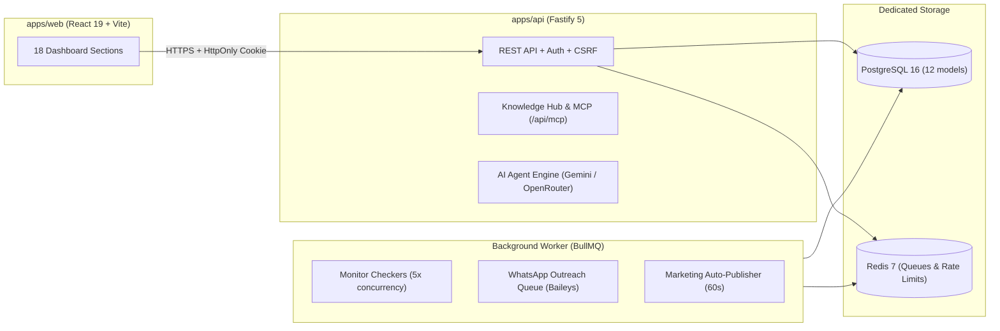

# Control Center

A self-hosted mission control center for infrastructure, operations, growth, and knowledge: domains, websites, databases, VPS security, secrets vault, deployments, B2B sales outreach, multi-brand marketing, retail deal monitoring, and AI agent orchestration.

## Architecture & Modules



| Pillar | Dashboard Sections | What it does |
|---|---|---|
| **1. Monitoring & Infra** | `Overview`, `Domains`, `Databases`, `Backups`, `Cloudflare`, `Vercel` | Scheduled uptime, SSL, RDAP domain renewal, Postgres/Redis health, Rclone encrypted cloud backups, Cloudflare DNS/WAF, and Vercel project status. |
| **2. VPS & DevSecOps** | `VPS`, `Deploys`, `Vault`, `Files`, `Terminal` | Live VPS telemetry & SSH/port security audits, CI/CD webhook & manual Docker Compose deployments, `.env` secrets vault with disk/git diff auditing, sandboxed file manager, and web terminal. |
| **3. Growth (Sales & Marketing)** | `Sales` (`/leads`), `Marketing`, `Deals` (`/promociones`) | Google Maps & Instagram lead scraping, AI pitch generation, paced WhatsApp outreach via Baileys, multi-brand social drafts with one-click WhatsApp/Telegram client approval, ad budget guardrails, and live Argentine bank/retail price-glitch monitoring. |
| **4. Intelligence & Engineering** | `Agents`, `Knowledge Base`, `Improvements`, `Learning` | Autonomous coding/ops agent with repository tools, Markdown Knowledge Base + daily interactive repository architecture graph + MCP server, Kanban backlog, and interactive study quizzes across 12 stack modules. |

---

## Monitoring Core

| Concept | Table | Meaning |
|---|---|---|
| Target | `targets` | Something watched (`domain`, `website`, `vercel_project`, `github_repo`, `server`, `service`, `database`). |
| Monitor | `monitors` | One checker run against one target on an interval (e.g. `ssl-expiry` every 24 h). |
| Result | `results` | What happened each time a monitor ran: status, duration, message, numeric metrics, and structured details. |
| Incident | `incidents` | A problem with a start and an end, so one outage means one alert, not one per check. |

Statuses: `ok` · `warn` (works, needs attention) · `fail` (broken) · `error` (the check itself could not run).
A target's status is the worst status among its monitors.

New things to watch are added as **checkers** (`apps/api/src/checkers/`): one file that follows a common contract (`defineChecker` in `define.ts`).

| Checker | Applies to | Default interval | What it reports |
|---|---|---|---|
| `http-uptime` | website, service | 5 min | Status code and response time; can require a redirect (e.g. a login wall that must stay in front). |
| `ssl-expiry` | website, service, domain | 24 h | Whether the certificate is trusted and how many days are left. |
| `domain-expiry` | domain | 24 h | Registration record from RDAP: expiry, registrar, DNS provider, DNSSEC, transfer lock. |
| `postgres-health` | database | 5 min | Version, size, connections, uptime, cache hit rate, biggest tables. |
| `redis-health` | database | 5 min | Version, memory, keys, clients, persistence. |
| `backup-age` | database | 1 h | When the backup script last succeeded, its size, and any warnings it printed. |

### Watching databases safely

- Each watched Postgres has a `cc_monitor` user that is only a member of `pg_monitor`: it reads statistics, never rows, and cannot write (`CREATE ROLE cc_monitor LOGIN PASSWORD '…' CONNECTION LIMIT 3 IN ROLE pg_monitor`).
- Connection URLs live in `.env` under names starting with `MONITOR_`; a target only names the variable, and checkers refuse any other name, so they can never be pointed at `DATABASE_URL` or another secret. The API never returns them.
- The backup checker reads only the backup script's log, mounted read-only, never the backup files.
- Server-specific wiring (joining the CMS network, the log mount, host mounts) lives in `docker-compose.vps.yml`, enabled with `COMPOSE_FILE` in `.env`, so `docker-compose.yml` stays portable.

---

## Processes & Database Models

### Processes
- **API** (`apps/api/src/server.ts`): Fastify REST server, session auth, CSRF protection, AI agent runner, deployment orchestrator, and MCP server endpoint.
- **Worker** (`apps/api/src/worker.ts`):
  1. **Monitor scheduler**: syncs enabled monitors from Postgres into BullMQ job schedulers (Redis) every 60 s and runs up to 5 checks concurrently. A crashing or hanging checker becomes an `error` result instead of taking the worker down.
  2. **Outreach queue worker**: processes outbound WhatsApp messages via Baileys with human-like pacing (60–120 s between contacts).
  3. **Marketing scheduler**: checks and auto-publishes scheduled social drafts every 60 s.
- **Stdio MCP Server** (`scripts/mcp-server.mjs`): standalone Model Context Protocol server exposing `get_system_context` and `read_knowledge_doc` from `knowledge/`.

### Prisma Schema (12 Models)
- **Monitoring**: `Target`, `Monitor`, `Result`, `Incident`
- **Auth**: `User`, `Session`
- **Engineering**: `Improvement`, `LearningProgress`
- **Sales CRM**: `Lead`
- **Marketing & Growth**: `Brand`, `BrandConversation`, `SocialDraft`, `AdCampaign`

---

## Stack & Monorepo Layout

TypeScript 6 · Fastify 5 · PostgreSQL 16 + Prisma 7 · Redis 7 + BullMQ · React 19 + Vite 8 + TanStack Query + Tailwind 4 · Zod 4 · Baileys (WhatsApp) · `@google/genai` (Gemini) + OpenRouter · Vitest 5 · Docker Compose · GitHub Actions CI/CD.

```text
apps/api         Fastify API, checkers, BullMQ worker, agent, leads, marketing, vault, ops
apps/web         React 19 dashboard (18 sections registered in src/sections.tsx)
packages/shared  Zod schemas and TypeScript contracts shared by API and dashboard
knowledge/       Canonical architecture, DB schema, playbooks, and agent skill docs
scripts/         Stdio MCP server (mcp-server.mjs)
```

The control center has its **own** Postgres and Redis, separate from the services it watches, so it keeps working when they break.

---

## Security Model

### Authentication, Sessions & CSRF
- **Passwords**: `scrypt` (`N=2^16, r=8`), salted, compared in constant time. Unknown emails cost the same time as wrong passwords.
- **Sessions**: 256-bit random token in an `HttpOnly`, `Secure`, `SameSite=Lax` cookie; the database stores only its SHA-256 (7-day TTL).
- **Brute force**: 5 attempts per 15 minutes per IP, counted in Redis.
- **CORS & CSRF**: CORS allows only `DASHBOARD_ORIGIN`; state-changing requests (`POST`, `PUT`, `PATCH`, `DELETE`) must come from that origin.
- **No public sign-up**: create or reset a user on the server:
  ```sh
  docker compose run --rm tools pnpm --filter @cc/api user:create you@example.com
  ```

### Webhooks, MCP & Host Privileges
- **Deploy webhook (`/api/webhooks/deploy/:repo`)**: fails closed (`503`) if `DEPLOY_SECRET` is not configured. Rejects secrets in URL query parameters (`400`) so secrets never leak into logs; requires either `x-deploy-secret` header or GitHub's `x-hub-signature-256` HMAC header (compared in constant time), and validates `repo` / `branch` names before invoking `execFile`.
- **Knowledge & MCP endpoints (`/api/mcp`, `/api/agent/context`)**: require either an authenticated dashboard session cookie or a valid `MCP_API_TOKEN` via `Authorization: Bearer <token>` / `x-mcp-token`.
- **VPS host mounts (`docker-compose.vps.yml`)**: in production, the `api` container mounts `/home/adminnico`, `/var/run/docker.sock`, and `/:/host:ro` to power the Deploys, Vault, Backups, Security Audit, and Agent modules. Commands executed by `ops`, `deploy`, and `vault` use `execFile` without shell interpolation, and the AI agent's `run_command` tool enforces a blocklist against destructive and privilege-escalation primitives.

### Network & Known Limitations
- The dashboard calls the API at its own subdomain with `credentials: 'include'`. Set `VITE_API_URL` at build time (`https://control-api.nicoguzmandev.com` in production, `http://localhost:4101` for local tests). API responses set `Cache-Control: no-store`.
- **Known limitation**: the API is behind Cloudflare, and Spanish ISPs block Cloudflare IP ranges during LaLiga matches, so from Spain the dashboard cannot reach it at those times (it shows an error with Retry after 15 s).

---

## CI/CD (GitHub Actions)

Every push and pull request runs `.github/workflows/ci.yml`:
1. **`ci` job**: boots ephemeral PostgreSQL 16 and Redis 7 service containers, installs dependencies with `--frozen-lockfile`, generates the Prisma client, runs `pnpm typecheck`, runs all unit and integration tests (`pnpm test`), builds `@cc/api` and `@cc/web`, and verifies the multi-stage production Docker build (`docker/app.Dockerfile`).
2. **`deploy` job**: runs **only** on pushes to `main` and **only after `ci` passes**, triggering the VPS deployment webhook via the `x-deploy-secret` header.

---

## Production (on the VPS)

```sh
docker compose up -d --build      # migrate → api + worker, restarted automatically
docker compose ps                 # api shows (healthy)
docker compose logs -f worker     # one JSON line per check
```

- `migrate` applies pending migrations once and exits; `api` and `worker` start only if it succeeds.
- One image (`docker/app.Dockerfile`, multi-stage) runs both: `node dist/server.js` or `node dist/worker.js`, with no source, dev tools, or `.env` inside. `esbuild` bundles TypeScript; npm dependencies are installed with `pnpm deploy --prod`.
- `.pnpmfile.cjs` stops `@prisma/client`'s optional peers (Prisma CLI, TypeScript) from leaking into production, and the build keeps only the PostgreSQL query engine: 745 MB → 313 MB.
- The API listens on `127.0.0.1:4100` only. Logs rotate (3 × 10 MB per container); API and worker are capped at 256 MB of RAM.

---

## Development

Needs only Docker (or Node 22 + pnpm 10 locally). Node tools can run inside the `tools` container:

```sh
cp .env.example .env                              # set POSTGRES_PASSWORD, DATABASE_URL, DEPLOY_SECRET, MCP_API_TOKEN
docker compose up -d postgres redis
docker compose run --rm tools pnpm install
docker compose run --rm tools pnpm --filter @cc/api exec prisma migrate dev
docker compose run --rm tools pnpm --filter @cc/api db:seed  # load targets (safe to re-run)
docker compose run --rm --service-ports tools pnpm dev:api   # http://127.0.0.1:4101/health
docker compose run --rm tools pnpm dev:worker                # runs checks (stop the production worker first)

docker compose run --rm tools pnpm typecheck
docker compose run --rm tools pnpm test
```

Tests: unit tests for pure logic, checker tests against a local HTTP server (no internet), security guard tests for webhooks/MCP/agent policies, and integration tests against a real Postgres database (`TEST_DATABASE_URL`, created and migrated automatically; skipped when unset).

`GET /health` answers `200` when the database and Redis respond, and `503` (within 2 s) naming the part that is down.

---

## Knowledge Base

Detailed operational documentation lives in [`knowledge/`](./knowledge/index.md):
- [`knowledge/architecture.md`](./knowledge/architecture.md) — VPS hardware, Docker containers, virtual networks, and Cloudflare Zero-Trust topology.
- [`knowledge/database-schema.md`](./knowledge/database-schema.md) — Relational models and JSONB structures.
- [`knowledge/playbooks/`](./knowledge/playbooks/) — SOPs for deployment, disaster recovery, and outreach.
- [`knowledge/skills/`](./knowledge/skills/) — Agent skill guides (Gemini orchestrator, Maps scraper, WhatsApp outreach).
